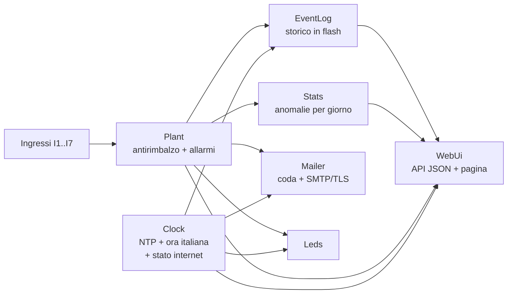
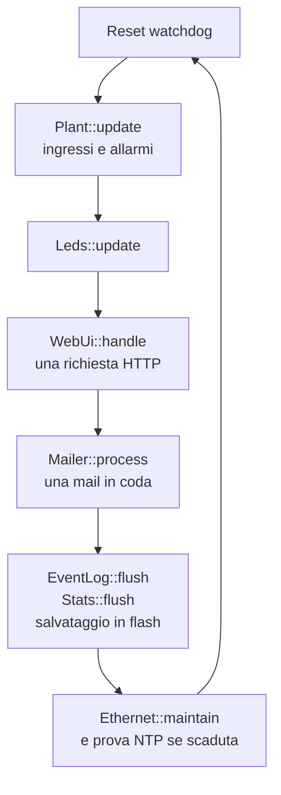
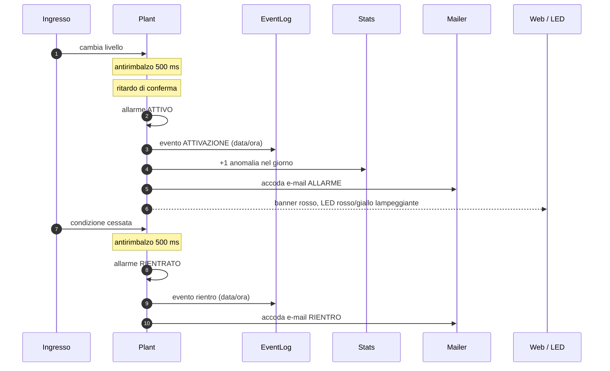
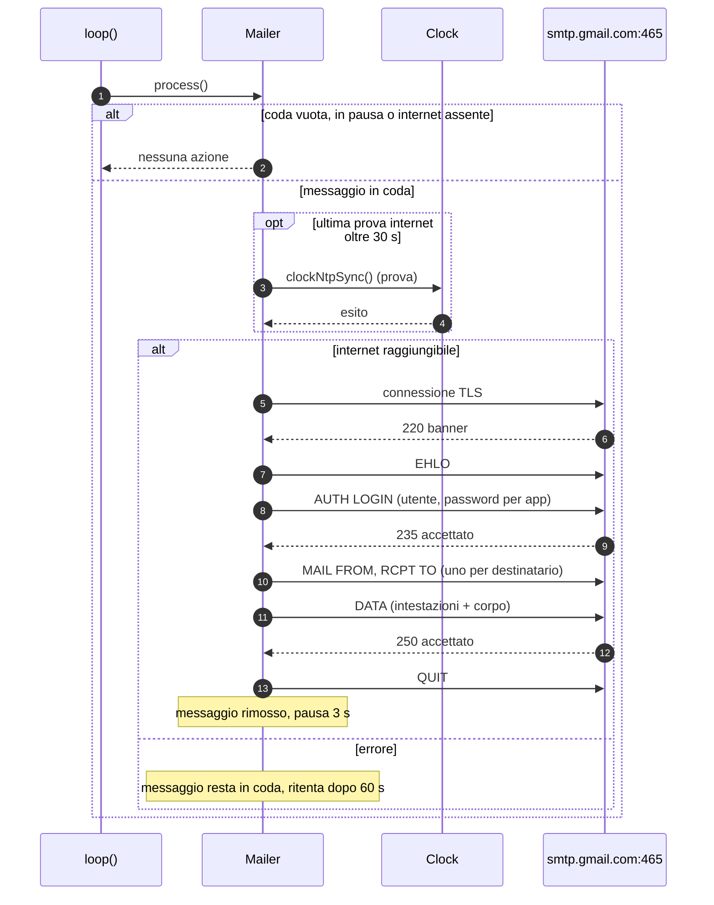
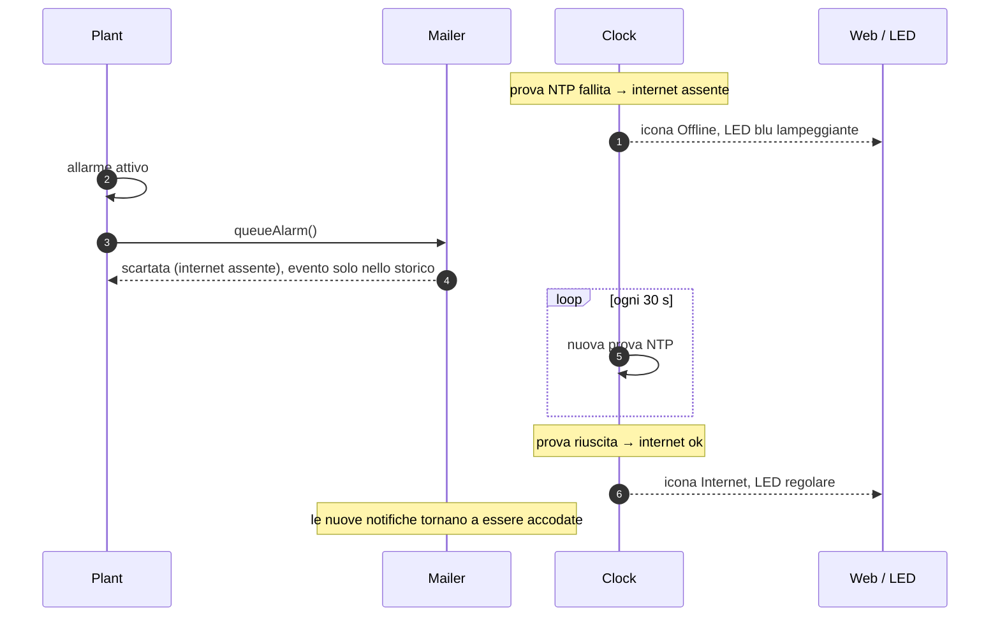
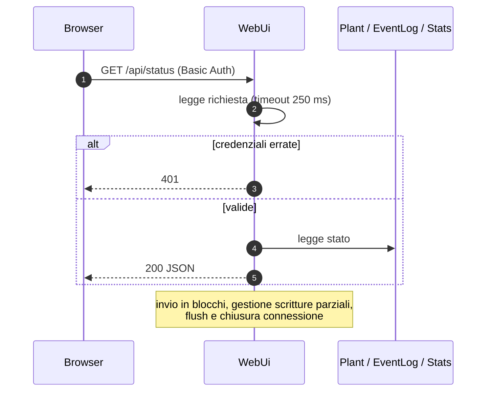
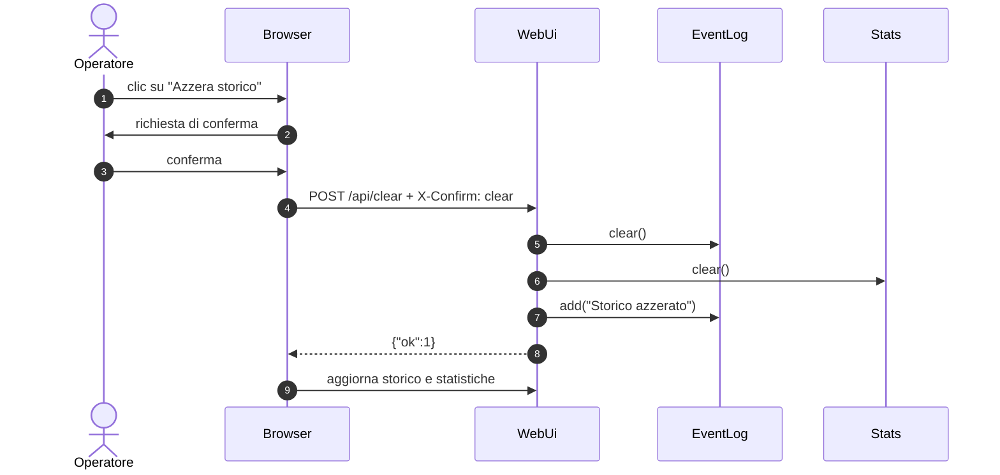
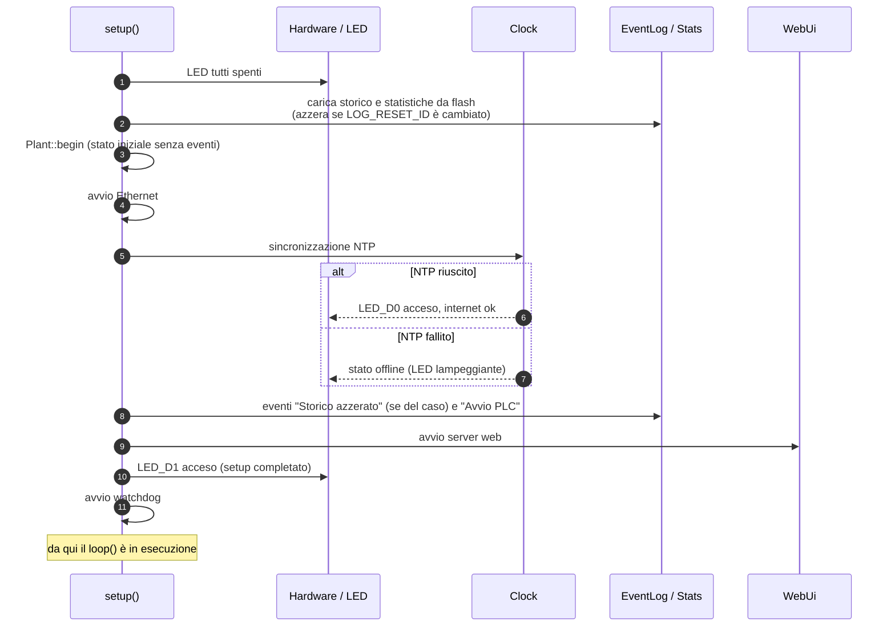

# OptaPompe — Supervisione allarmi stazione di sollevamento

**Sistema di monitoraggio basato su PLC Finder Opta**
Firmware Arduino (C++) per la supervisione di una stazione di sollevamento a due pompe, con interfaccia web, storico eventi, statistiche e notifiche e-mail.

| | |
|---|---|
| **Piattaforma** | Finder Opta (Arduino Mbed OS) |
| **Ambiente di sviluppo** | Arduino IDE, core *Arduino Mbed OS Opta Boards* |
| **Libreria esterna** | `ESP_SSLClient` (Mobizt), solo per le e-mail |
| **Interfaccia** | Pagina web su porta 80 (Basic Auth), LED di stato |
| **Notifiche** | E-mail via Gmail (SMTP su TLS, porta 465) |

> **Stato di verifica.** La logica (ingressi, allarmi, storico, statistiche, coda e-mail, gestione assenza internet, tipo di contatto) è stata verificata con test automatici su PC. La pagina web è stata verificata in browser. Il collaudo sul PLC reale è a cura dell'installatore (vedi [§14](#14-checklist-di-collaudo)).

---

## Indice

1. [Scopo e ambito](#1-scopo-e-ambito)
2. [Architettura](#2-architettura)
3. [Ingressi e cablaggio](#3-ingressi-e-cablaggio)
4. [Logica degli allarmi](#4-logica-degli-allarmi)
5. [Storico eventi](#5-storico-eventi)
6. [Statistiche giornaliere](#6-statistiche-giornaliere)
7. [Gestione di data e ora](#7-gestione-di-data-e-ora)
8. [Notifiche e-mail](#8-notifiche-e-mail)
9. [Funzionamento senza internet](#9-funzionamento-senza-internet)
10. [Interfaccia web](#10-interfaccia-web)
11. [LED di stato](#11-led-di-stato)
12. [Affidabilità, watchdog e persistenza](#12-affidabilità-watchdog-e-persistenza)
13. [Configurazione e installazione](#13-configurazione-e-installazione)
14. [Checklist di collaudo](#14-checklist-di-collaudo)
15. [Limiti noti](#15-limiti-noti)
16. [Struttura del progetto](#16-struttura-del-progetto)

---

## 1. Scopo e ambito

Il sistema supervisiona **due pompe** di una stazione di sollevamento e segnala le anomalie. È un sistema di **sola supervisione**: il PLC è collegato al quadro e alimentato da UPS, ma **non comanda le pompe** (nessuna uscita utilizzata).

**Funzioni**

- Rilevamento dello stato di marcia di ciascuna pompa.
- Allarme **protezione termica** pompa 1 / pompa 2.
- Allarme **galleggiante di troppo pieno** pompa 1 / pompa 2.
- Allarme **mancanza rete** sulla linea di alimentazione delle pompe.
- **Storico eventi** persistente con data/ora di attivazione e di rientro.
- **Statistiche**: numero di anomalie per giorno, con grafico mensile.
- **Interfaccia web** con stato in tempo reale, storico, statistiche ed esportazioni.
- **Notifiche e-mail** a ogni attivazione e rientro di allarme.
- **LED di stato** sul frontale della scheda.

**Fuori ambito**: comando delle pompe; allarme di “mancato avviamento” (richiederebbe un'uscita di comando da confrontare con la marcia).

---

## 2. Architettura

### 2.1 Moduli software



| Modulo | File | Responsabilità |
|---|---|---|
| Principale | `OptaPompe.ino` | `setup()` e ciclo `loop()`, watchdog |
| Configurazione | `config.h` | Tutti i parametri d'impianto |
| Credenziali | `secrets.h` | Account e password per app Gmail (non condiviso) |
| Impianto | `Plant.*` | Lettura ingressi, antirimbalzo, ritardi, allarmi |
| Storico | `EventLog.*` | Buffer circolare persistente degli eventi |
| Statistiche | `Stats.*` | Conteggio giornaliero delle anomalie |
| Orologio | `Clock.*` | NTP, ora italiana con ora legale, stato internet |
| E-mail | `Mailer.*` | Coda messaggi e invio SMTP su TLS |
| Web | `WebUi.*`, `WebPage.h` | Server HTTP, API JSON, pagina |
| LED | `Leds.*` | Segnalazioni sul frontale |

### 2.2 Ciclo principale

Il firmware è **cooperativo e a thread unico**: tutto avviene nel `loop()`, in quest'ordine.



Il sistema **non è real-time**: un allarme può essere rilevato e registrato con qualche secondo di scarto (principalmente a causa dei ritardi di conferma e dell'invio e-mail, circa 1,5 s a messaggio). Questo non influisce sul funzionamento: l'importante è che il ritardo non derivi nel tempo.

---

## 3. Ingressi e cablaggio

### 3.1 Assegnazione

| Ingresso | Pin | Segnale | Evento rilevato |
|---|---|---|---|
| I1 | `A0` | Pompa 1 in marcia | Pompa 1 in marcia |
| I2 | `A1` | Pompa 2 in marcia | Pompa 2 in marcia |
| I3 | `A2` | Termica pompa 1 | Termica scattata |
| I4 | `A3` | Termica pompa 2 | Termica scattata |
| I5 | `A4` | Galleggiante troppo pieno pompa 1 | Livello troppo pieno |
| I6 | `A5` | Galleggiante troppo pieno pompa 2 | Livello troppo pieno |
| I7 | `A6` | Rete linea pompe | Rete assente |
| I8 | `A7` | Libero | — |

### 3.2 Tipo di contatto configurabile (NO / NC)

Per ogni ingresso si indica in `config.h` il tipo di contatto, **riferito all'evento da rilevare**:

| Valore | Significato |
|---|---|
| `CONTACT_NO` | A riposo nessun segnale; l'**evento porta il segnale** (24 V, livello alto) |
| `CONTACT_NC` | A riposo il segnale c'è; l'**evento lo toglie**. Filo tagliato o mancanza 24 V sono letti come evento (**sicurezza intrinseca**) |

Configurazione predefinita:

```c
#define CONTACT_PUMP1_RUN  CONTACT_NO
#define CONTACT_PUMP2_RUN  CONTACT_NO
#define CONTACT_THERMAL1   CONTACT_NC
#define CONTACT_THERMAL2   CONTACT_NC
#define CONTACT_OVERFILL1  CONTACT_NO
#define CONTACT_OVERFILL2  CONTACT_NO
#define CONTACT_MAINS      CONTACT_NC
```

Per cambiare il fronte del segnale di un ingresso è sufficiente invertire `NO` ↔ `NC`; tutto il resto (allarmi, LED, web, storico, e-mail) si adegua automaticamente perché l'inversione è applicata una sola volta, alla lettura.

> Le termiche e la rete sono predisposte NC per ottenere l'allarme anche in caso di guasto del cablaggio.

---

## 4. Logica degli allarmi

Ogni ingresso passa due filtri prima di diventare un allarme:

1. **Antirimbalzo** (`DEBOUNCE_MS` = 500 ms): il valore cambia solo se resta stabile per l'intero intervallo.
2. **Ritardo di conferma** dell'allarme: la condizione deve persistere per il tempo indicato.

| Allarme | Condizione | Ritardo |
|---|---|---|
| Mancanza rete linea pompe | Rete assente | `MAINS_DELAY_MS` = 2 s |
| Termica pompa 1 / 2 | Termica scattata | `THERMAL_DELAY_MS` = 1 s |
| Troppo pieno pompa 1 / 2 | Galleggiante raggiunto | `OVERFILL_DELAY_MS` = 2 s |

Il **rientro** avviene appena la condizione cessa (dopo l'antirimbalzo). La marcia delle pompe non è un allarme: genera solo eventi informativi di *start* e *stop*.

### 4.1 Sequenza di un allarme



Allo **stato iniziale** (avvio) lo stato dei contatti viene letto senza generare eventi: un allarme già presente all'accensione si attiva regolarmente dopo il proprio ritardo.

---

## 5. Storico eventi

- **Capienza**: `LOG_SIZE` = 128 eventi, in buffer circolare (il più vecchio viene sovrascritto).
- **Persistenza**: salvato in memoria flash (KVStore, chiave `/kv/evlog`). Sopravvive a riavvii e mancanza di alimentazione. Il salvataggio avviene al più ogni 5 secondi per limitare l'usura della flash.
- **Contenuto di ogni evento**: data/ora, tipo, attivazione/rientro.

| Evento | Tipo |
|---|---|
| Avvio PLC | informativo |
| Storico azzerato | informativo |
| Pompa 1 / 2 in marcia (start / stop) | informativo |
| Mancanza rete linea pompe | allarme (ATTIVAZIONE / rientro) |
| Termica pompa 1 / 2 | allarme |
| Troppo pieno pompa 1 / 2 | allarme |

Gli eventi avvenuti quando l'ora non era valida riportano **“n/d”**.

### 5.1 Azzeramento dello storico

Due modi, che azzerano **storico e statistiche insieme**:

| Metodo | Come |
|---|---|
| **Da configurazione** | Incrementare `LOG_RESET_ID` in `config.h` e ricaricare il firmware. L'azzeramento avviene una sola volta, al primo avvio con il nuovo valore |
| **Da pagina web** | Pulsante **Azzera storico**, con conferma. Richiede una richiesta `POST` con intestazione di conferma |

Dopo l'azzeramento viene registrato l'evento *Storico azzerato*.

---

## 6. Statistiche giornaliere

- Ogni **attivazione** di un allarme incrementa il contatore del **giorno locale** (ora italiana, con ora legale).
- I rientri **non** sono conteggiati.
- Gli eventi senza ora valida vengono contati a parte come **“senza data”**.
- Si conservano gli ultimi `STATS_DAYS` = 90 giorni *con anomalie*; i giorni senza anomalie non occupano memoria.
- Persistenza in flash (chiave `/kv/stats`), azzerate insieme allo storico.

---

## 7. Gestione di data e ora

- All'avvio e periodicamente la scheda interroga un server **NTP** (`NTP_SERVER`, predefinito `pool.ntp.org`) e aggiorna l'RTC interno in UTC.
- La visualizzazione usa l'**ora italiana**: UTC+1 in inverno, UTC+2 in estate, con cambio ora legale calcolato dal firmware (ultima domenica di marzo e di ottobre, alle 01:00 UTC).
- Un'ora è considerata **valida** solo dopo la prima sincronizzazione riuscita.
- Ogni sincronizzazione NTP è anche la **prova di raggiungibilità di internet** (vedi §9).

---

## 8. Notifiche e-mail

### 8.1 Caratteristiche

| Parametro | Valore |
|---|---|
| Server | `smtp.gmail.com`, porta **465** (TLS diretto) |
| Autenticazione | `AUTH LOGIN` con **password per app** Google (richiede verifica in due passaggi) |
| Mittente | l'account Gmail di `secrets.h` |
| Destinatari | `MAIL_TO`, anche più indirizzi separati da virgola |
| Contenuto | Oggetto `[Pompe] ALLARME: <nome>` o `[Pompe] RIENTRO: <nome>`, con evento e data/ora |
| Coda | fino a 8 messaggi; se piena, i nuovi non sono accodati (restano nello storico) |
| Cadenza | pausa di `MAIL_GAP_MS` (3 s) dopo un invio; ripresa dopo `MAIL_RETRY_MS` (60 s) in caso di errore |

Libreria TLS: `ESP_SSLClient` sopra il client Ethernet.

### 8.2 Sequenza di invio



L'invio avviene **nel ciclo principale** e blocca il ciclo per circa 1,5 s a messaggio.

### 8.3 Sicurezza delle credenziali

Account e password per app sono in `secrets.h`, **escluso** dai pacchetti distribuiti. Non va condiviso né pubblicato. Per impostazione predefinita il certificato del server non è verificato (`MAIL_TLS_INSECURE 1`): la connessione è cifrata ma non autenticata lato server. La verifica è predisposta (`MAIL_TLS_INSECURE 0` con `certs.h`) ma non è stata collaudata.

---

## 9. Funzionamento senza internet

Il sistema è progettato perché **l'assenza di internet non comprometta la supervisione**.

| Funzione | Con internet assente |
|---|---|
| Lettura ingressi, allarmi, LED pompe | **Attivi** |
| Storico e statistiche | **Attivi** (eventi con data se l'ora era già sincronizzata, altrimenti “n/d”) |
| Pagina web (rete locale) | **Attiva** |
| E-mail | **Non inviate**: nessun tentativo di connessione |
| Indicazione | Icona **Offline** in pagina; LED blu lampeggiante |

### 9.1 Rilevamento

- La prova è una richiesta NTP (UDP, attesa massima 1,5 s).
- Con internet: ripetuta ogni `NET_CHECK_MS` (10 min), così si rileva anche una caduta successiva.
- Senza internet: ripetuta ogni `NET_RETRY_MS` (30 s).
- Prima di ogni invio e-mail la prova viene ripetuta se più vecchia di `MAIL_PROBE_MS` (30 s).

### 9.2 Sequenza



Le e-mail **già in coda** al momento della caduta restano in coda e partono al ritorno della rete.

---

## 10. Interfaccia web

Accesso: `http://<indirizzo IP del PLC>/` — autenticazione **HTTP Basic**. Credenziali predefinite `admin` / `admin`, **da cambiare** (`WEB_AUTH_B64`, base64 di `utente:password`).

La pagina si aggiorna da sola ogni 3 s (30 s per le statistiche) ed è adatta a PC e smartphone, con tema chiaro/scuro automatico.

### 10.1 Vista Monitoraggio

- **Intestazione**: indicatore connessione internet (Internet / Offline) e ora del PLC.
- **Banner** di stato complessivo (impianto regolare / numero di allarmi attivi).
- **Schede pompa 1 e 2**: marcia, termica, troppo pieno.
- **Scheda rete** linea pompe.
- **Elenco allarmi** con stato e data di attivazione.
- **Storico eventi** con filtro; pulsanti **Scarica (.txt)** e **Azzera storico**.

### 10.2 Vista Statistiche (`#statistiche`)

- Grafico a barre delle **anomalie per giorno**, un mese alla volta, con frecce per scorrere i mesi.
- Riepilogo: anomalie nel mese, giorni con anomalie, massimo in un giorno, eventi “senza data”.
- Pulsante **Esporta dati (.csv)**.

### 10.3 Esportazioni

| File | Contenuto |
|---|---|
| `storico_eventi_AAAA-MM-GG.txt` | Intestazione, data di esportazione, eventi in ordine cronologico con data/ora, nome ed evento |
| `anomalie_giornaliere_AAAA-MM-GG.csv` | `Data;Anomalie` per tutti i giorni dal primo conservato a oggi (zeri inclusi), più eventuale riga `senza data` |

I file sono generati nel browser a partire dai dati letti dal PLC (UTF-8, apribili con Excel).

### 10.4 Interfaccia di programmazione (JSON)

| Richiesta | Risposta |
|---|---|
| `GET /` | Pagina web |
| `GET /api/status` | Ora, stato internet, rete, pompe, allarmi |
| `GET /api/events` | Storico, dal più recente |
| `GET /api/stats` | Anomalie per giorno |
| `POST /api/clear` | Azzera storico e statistiche (richiede intestazione `X-Confirm: clear`; altrimenti `405`) |

Richieste senza credenziali valide ricevono `401`.

### 10.5 Sequenza di una richiesta



### 10.6 Sequenza di azzeramento dello storico



---

## 11. LED di stato

| LED | Significato |
|---|---|
| `LED_D0` | Acceso fisso: internet/NTP raggiungibile. Spento all'avvio finché non c'è NTP. Lampeggiante: internet assente (solo se la scheda non ha il LED blu) |
| `LED_D1` | Acceso a fine avvio, con pagina web attiva |
| `LED_D2` | Lampeggia con la pompa 1 in marcia |
| `LED_D3` | Lampeggia con la pompa 2 in marcia |
| LED blu (`LED_USER`, solo variante WiFi) | Lampeggia se internet è assente |
| LED sotto il tasto RESET | **Verde fisso**: tutto regolare · **Rosso lampeggiante**: almeno un allarme · **Giallo lampeggiante**: mancanza rete (prevale sul rosso) |

All'accensione tutti i LED sono spenti. Pin e polarità sono modificabili in `config.h`.

---

## 12. Affidabilità, watchdog e persistenza

- **Watchdog** hardware (`WDT_TIMEOUT_MS` = 25 s): se il ciclo si blocca, la scheda si riavvia da sola. Viene azzerato nel ciclo e durante le attese di rete.
- **Antirimbalzo e ritardi** contro disturbi e commutazioni spurie.
- **Aritmetica dei tempi senza segno**: i temporizzatori restano corretti dopo mesi di funzionamento, anche quando il contatore dei millisecondi riparte da zero.
- **Persistenza** di storico e statistiche in flash, con scritture ritardate (≥ 5 s).
- **Trasmissione web** robusta: contenuto con lunghezza dichiarata, scritture parziali gestite, chiusura ordinata della connessione.
- **Ingressi a sicurezza intrinseca** con contatti NC dove previsto.

---

## 13. Configurazione e installazione

### 13.1 Requisiti

1. Arduino IDE con il core **Arduino Mbed OS Opta Boards**.
2. Libreria **ESP_SSLClient** (Gestione librerie), necessaria solo con `MAIL_ENABLED 1`.
3. Un account Gmail dedicato con **verifica in due passaggi** e **password per app**.

### 13.2 Procedura

1. Aprire la cartella `OptaPompe` in Arduino IDE (`OptaPompe.ino`).
2. Creare/modificare `secrets.h`:
   ```c
   #define SMTP_USER "indirizzo@gmail.com"
   #define SMTP_PASS "password per app"
   ```
3. Verificare in `config.h` almeno: rete (`NET_IP`, `NET_DNS`, `NET_GATEWAY`, `NET_SUBNET`), `MAIL_TO`, `WEB_AUTH_B64`, tipi di contatto `CONTACT_*`.
4. Selezionare la scheda Finder Opta, compilare e caricare.
5. Aprire il monitor seriale a 115200 baud per i messaggi di avvio.

> **Rete.** Con IP fisso, **DNS e gateway devono essere reali** e consentire l'uscita su internet, altrimenti NTP e posta non funzionano (il PLC resterebbe in modalità “offline”).

### 13.3 Parametri principali (`config.h`)

| Parametro | Predefinito | Descrizione |
|---|---|---|
| `CONTACT_*` | vedi §3.2 | Tipo di contatto per ingresso |
| `DEBOUNCE_MS` | 500 | Antirimbalzo ingressi |
| `MAINS_DELAY_MS` / `THERMAL_DELAY_MS` / `OVERFILL_DELAY_MS` | 2000 / 1000 / 2000 | Ritardi di conferma allarme |
| `WDT_TIMEOUT_MS` | 25000 | Timeout watchdog |
| `NET_USE_DHCP`, `NET_IP`, `NET_DNS`, `NET_GATEWAY`, `NET_SUBNET` | IP fisso 192.168.1.50 | Rete |
| `NTP_SERVER` | `pool.ntp.org` | Server orario |
| `NET_CHECK_MS` / `NET_RETRY_MS` / `MAIL_PROBE_MS` | 10 min / 30 s / 30 s | Prove di internet |
| `WEB_PORT`, `WEB_AUTH_B64` | 80, `admin:admin` | Web (cambiare la password) |
| `SMTP_HOST`, `SMTP_PORT` | `smtp.gmail.com`, 465 | Server di posta |
| `MAIL_TO` | segnaposto | Destinatari (separati da virgola) |
| `MAIL_ENABLED` | 1 | 0 = e-mail disabilitate (libreria non necessaria) |
| `MAIL_GAP_MS` / `MAIL_RETRY_MS` | 3 s / 60 s | Pausa tra invii / ritentativo |
| `MAIL_TEST_AT_BOOT` | 0 | 1 = invia una mail di prova all'avvio |
| `MAIL_TLS_INSECURE` | 1 | 0 = verifica certificato (richiede `certs.h`) |
| `LOG_SIZE` | 128 | Eventi in storico |
| `STATS_DAYS` | 90 | Giorni con anomalie conservati |
| `LOG_RESET_ID` | 1 | Cambiare il valore per azzerare storico e statistiche |
| `DEBUG_HEARTBEAT`, `MAIL_DEBUG` | 0, 1 | Diagnostica sulla seriale |

### 13.4 Sequenza di avvio



---

## 14. Checklist di collaudo

| # | Prova | Esito atteso |
|---|---|---|
| 1 | Accensione con rete e internet | LED_D0 e LED_D1 accesi, LED RESET verde fisso, pagina raggiungibile |
| 2 | Avviare la pompa 1 e la pompa 2 | LED_D2 / LED_D3 lampeggiano, evento *start* in storico; allo stop, evento *stop* |
| 3 | Simulare termica scattata (pompa 1 e 2) | Dopo ~1 s allarme, LED rosso lampeggiante, e-mail, evento ATTIVAZIONE; al ripristino evento *rientro* ed e-mail |
| 4 | Simulare troppo pieno (pompa 1 e 2) | Come sopra, dopo ~2 s |
| 5 | Togliere la tensione di rete alle pompe | Dopo ~2 s LED giallo lampeggiante, allarme, e-mail |
| 6 | Scollegare un filo di un contatto NC (termica o rete) | Allarme (sicurezza intrinseca) |
| 7 | Cambiare un `CONTACT_*`, ricaricare, ripetere la prova | Il comportamento si inverte come previsto |
| 8 | Scollegare internet (cavo verso il router/WAN) | Icona *Offline*, LED blu lampeggiante, **nessun riavvio** della scheda, pagina sempre raggiungibile |
| 9 | Generare un allarme da offline | Evento nello storico, **nessuna e-mail** |
| 10 | Ripristinare internet | Icona *Internet*, notifiche di nuovo attive |
| 11 | Togliere e ridare alimentazione | Storico e statistiche conservati |
| 12 | Scaricare storico `.txt` e dati `.csv` | File corretti, apribili in Excel |
| 13 | Azzerare lo storico da pagina | Storico e statistiche vuoti, evento *Storico azzerato* |
| 14 | Verificare la data/ora (e, se possibile, il cambio ora legale) | Ora italiana corretta |

---

## 15. Limiti noti

- **Non real-time**: ritardi di qualche secondo tra evento e registrazione/notifica sono normali.
- **E-mail nel ciclo principale**: ogni invio blocca il ciclo per circa 1,5 s (LED e web possono rallentare brevemente).
- **Internet assente**: durante la prova NTP (ogni 30 s) il ciclo si ferma fino a 1,5 s. Resta un caso residuo: se NTP risponde ma il server di posta no, l'attesa può arrivare al watchdog e causare un riavvio.
- **Ora non valida**: nelle prime ore senza internet gli eventi hanno “n/d” e le anomalie sono contate come “senza data”.
- **Verifica certificato TLS** disattivata per impostazione predefinita (§8.3).
- **LED blu** presente solo sulla variante Opta WiFi; sulla variante standard viene usato `LED_D0`.
- **Mancato avviamento** non rilevabile (nessuna uscita di comando).
- **Credenziali web** predefinite da sostituire; la comunicazione web è in HTTP non cifrato, adatta a rete locale protetta.
- **Limite Gmail**: circa 500 messaggi al giorno.
- Se la mancanza di rete provoca anche l'apertura dei circuiti delle termiche, si attiveranno anche gli allarmi termica.

---

## 16. Struttura del progetto

```
OptaPompe/
├── OptaPompe.ino      Programma principale (setup, loop, watchdog)
├── config.h           Configurazione d'impianto
├── secrets.h          Credenziali e-mail (NON condividere)
├── Plant.h/.cpp       Ingressi, antirimbalzo, allarmi
├── EventLog.h/.cpp    Storico eventi persistente
├── Stats.h/.cpp       Statistiche giornaliere
├── Clock.h/.cpp       NTP, ora italiana, stato internet
├── Mailer.h/.cpp      Coda e invio e-mail
├── WebUi.h/.cpp       Server web e API JSON
├── WebPage.h          Pagina web (HTML/CSS/JS incorporati)
├── Leds.h/.cpp        LED di stato
├── Wdt.h              Interfaccia del watchdog
├── anteprima_web.html Anteprima della pagina con dati simulati
├── TlsTest/           Sketch di prova della connessione TLS
└── README.md          Questo documento
```
